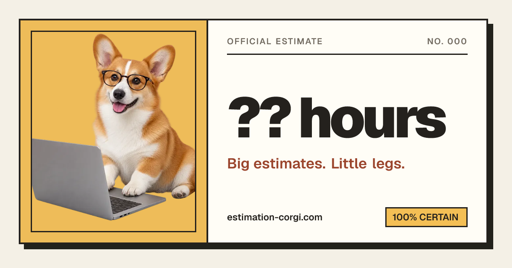

<div align="center">

<a href="https://estimation-corgi.com">
  
</a>

# Estimation Corgi

**Big estimates. Little legs.**

Hand your deadline to a corgi with absolutely no context and an unreasonable amount of confidence.

[](https://github.com/StefanWin/estimation-corgi/actions/workflows/quality.yml)
[](LICENSE)
[](https://estimation-corgi.com)

[**Get an estimate →**](https://estimation-corgi.com) · [Submit a hot take](https://estimation-corgi.com/suggest) · [Top hot takes](https://estimation-corgi.com/meta)

</div>

---

## 🐾 What it does

- 🎲 **Instant estimates.** A random corgi gives your task a random 1–40 hour estimate, with a hot take to back it up.
- 🔗 **Shareable.** Every estimate has its own link, and pasting it into chat unfurls a preview card like the one above.
- 🗣️ **Community hot takes.** Anyone can submit a message. Submissions go through Turnstile and moderation before they show up.
- 👍 **Likes and leaderboard.** Like the takes that hit too close to home; the best ones rise to the top of [`/meta`](https://estimation-corgi.com/meta).
- 🌗 **Light and dark mode.** Because estimates are often given at 2 a.m.

## 🧰 Stack

| Layer | Tech |
| --- | --- |
| Frontend | React 19, Vite, Material UI, TypeScript |
| Hosting | Cloudflare Workers via the `cf` CLI and the Cloudflare Vite plugin |
| Data | Convex for messages, likes and submissions |
| Preview cards | satori + resvg, rendered in the Worker |
| Spam protection | Cloudflare Turnstile |

## 🚀 Local development

Use Node.js 24 and pnpm 12.

```powershell
pnpm install
Copy-Item env.example .env.local
pnpm dev
```

`pnpm dev` runs `convex dev` and starts `cf dev` alongside it, which runs the Vite development server with the Workers runtime integration. The Worker is configured in `cloudflare.config.ts`. Set the client-side variables in `.env.local`:

```dotenv
VITE_CONVEX_URL=https://your-deployment.convex.cloud
VITE_TURNSTILE_SITE_KEY=
```

Convex secrets such as `TURNSTILE_SECRET_KEY` remain in the Convex deployment; they are not exposed to the browser or Worker.

> [!IMPORTANT]
> Message submissions require Turnstile. Set `VITE_TURNSTILE_SITE_KEY` for the frontend and `TURNSTILE_SECRET_KEY` in Convex. Use the test keys in `env.example` for development and real keys in production. Missing captcha configuration rejects submissions; there is no verification bypass.

### Useful commands

| Command | What it does |
| --- | --- |
| `pnpm dev` | Start Convex dev and the dev server with the Workers runtime |
| `pnpm types` | Generate Worker types and type-check |
| `pnpm build` | Type-check and build the SPA and Worker |
| `pnpm preview` | Preview the production build |
| `pnpm lint` / `pnpm format` | Check / fix with Biome |

## ☁️ Deploy to Cloudflare Workers

> [!NOTE]
> Deployments run through Cloudflare's Git integration, never locally.

Configure:

- Build command: `pnpm run build`
- Deploy command: `pnpm run deploy:convex`
- Build environment: the production `CONVEX_DEPLOY_KEY` and the `VITE_*` values above. `VITE_CONVEX_URL` must point to the same production deployment as the deploy key because Vite embeds it during the separate build step.

The build command generates the Worker types, type-checks, and runs `cf build`, which writes the SPA assets and Worker to `.cloudflare/output`. The deploy command deploys Convex first, invokes production migrations with `--prod`, then calls `cf deploy --prebuilt` to publish the already-built output. A failed Convex deployment or migration invocation stops the chain before publishing the frontend. Migrations run in the background, so successful invocation does not mean their backfills have finished; schema-tightening changes require the completed backfill described below.

`pnpm run deploy` only calls `cf deploy --prebuilt`; it does not build the SPA. Do not commit `.cloudflare`.

`cloudflare.config.ts` enables `single-page-application` fallback, so direct navigation to `/suggest`, `/meta`, and `/privacy` works on the Worker. Configure a custom domain or Workers route in Cloudflare after the first deploy.

> [!WARNING]
> Before deploying the required `normalizedMessage` schema for the first time, run the already-deployed `migrations:runAll` function in the production Convex dashboard. Wait for `backfillNormalizedMessages` to finish in the migrations component. Migration runners return before their background work finishes. If any message still lacks a normalized key, schema validation will reject the deployment. New submissions always write the key, and duplicate detection uses only the `by_normalized_message` index.

## 🖼️ Link previews

<details>
<summary>How the Worker renders and caches preview cards</summary>

<br>

The Worker in `worker/` runs before static assets for `/` and `/og`. For share links (`/?i=&m=&v=&t=`) it adds Open Graph tags to the page, and `/og` renders the matching 1200×630 preview card as a PNG with satori and resvg. resvg can't decode WebP, so the corgi portrait is converted to PNG first. Rendered cards are cached in the Workers cache.

All rendered previews (including defaults and unresolved links) have a five-minute Worker cache lifetime. After expiry, the next request checks the current message content and approval in Convex before rendering; an unapproved, deleted, or unavailable message produces the generic card. Edits and moderation changes can therefore take up to five minutes to appear on requests reaching the Worker. Image responses use `Cache-Control: no-store` on both cache hits and misses so browser and downstream CDN caches do not add another cache window.

Generated image URLs include `rev=2`, and the Worker uses that version in its internal cache key even for older URLs, bypassing the previous one-year immutable Worker entries. Already-downloaded images at old URLs cannot be revoked from browser caches. Social platforms may also retain their own preview snapshots regardless of HTTP cache headers; refreshing those requires the platform's recrawl mechanism. Existing share links and saved estimates remain valid.

</details>

## 📄 License

Code is [MIT](LICENSE). Corgi image credits are listed on [`/meta`](https://estimation-corgi.com/meta).
